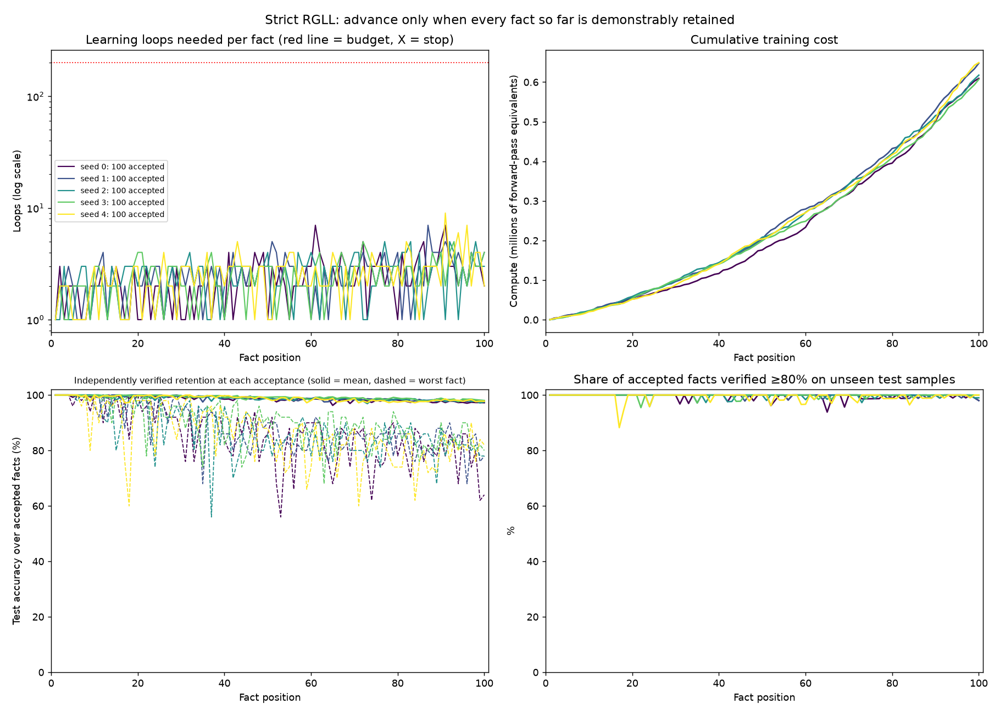
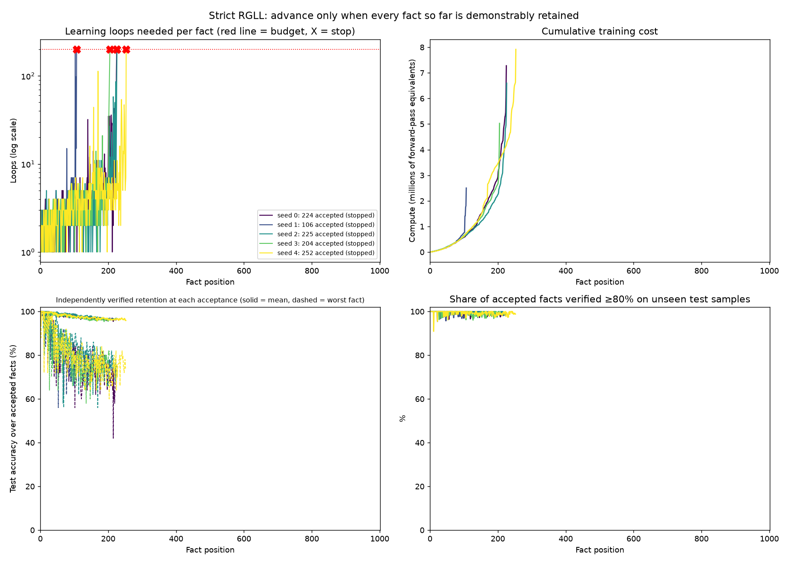

# Retention-Gated Learning Loops (RGLL): prototype

Originator: Jonathan Harriss. Hypothesis dated 20 October 2026; prototype built 21 October 2026.

> A neural network processes information sequentially, repeating an internal learning loop
> until the current information is demonstrably retained alongside everything previously
> learned. Only then does it advance.

**Learn it. Retain it. Prove it. Then move on. If you cannot retain everything, stop.**

## Controlling specification: strict RGLL

This is the hypothesis as Jonathan stated it, and it is the specification this project answers to:

1. Present fact 1 and train until it is demonstrably retained.
2. Present fact 2 and train until facts 1 **and** 2 are demonstrably retained.
3. Continue, checking **every** previously accepted fact at every progression point.
4. If retention fails, repeat the learning loop.
5. Never advance while any accepted fact fails retention. No deferral, no skipping, no recovery pass.
6. A resource budget may prevent infinite execution, but **reaching it means STOP, not advance**.
   The stopping point is the result: the ceiling under the tested architecture, training method and budget.

Code: [rgll/strict.py](rgll/strict.py), [run_strict.py](run_strict.py). Results: [results_strict/](results_strict/summary.md).

### Strict result (5 seeds, 100 facts, main-setting world and network)

The setup was frozen in [results_strict/config.json](results_strict/config.json) (with code SHA-256 hashes)
before training. The new fact had to reach ≥90% and every accepted fact ≥80% on probe samples it never trained on.
The budget was 200 loops (2,000 updates) per fact.

| Seed | Facts accepted | Outcome | Loops | Training updates | Compute | Most loops for any one fact |
|---|---|---|---|---|---|---|
| 0 | **100 / 100** | completed, no stop | 244 | 2,440 | 0.61 M | 7 |
| 1 | **100 / 100** | completed, no stop | 261 | 2,610 | 0.65 M | 7 |
| 2 | **100 / 100** | completed, no stop | 253 | 2,530 | 0.62 M | 5 |
| 3 | **100 / 100** | completed, no stop | 247 | 2,470 | 0.61 M | 5 |
| 4 | **100 / 100** | completed, no stop | 261 | 2,610 | 0.65 M | 9 |

**What happened:**

- **The network never stopped.** Every seed learned and retained all 100 facts together, passing every
  check on every fact. The hardest single fact needed 9 loops, far below the 200-loop budget, so **no ceiling
  was reached within 100 facts** under this setup.
- **The cost of each new fact rose steadily as the accepted set grew.** Loops per fact went from 1.7 (facts 1–10)
  to 3.2 (facts 76–100). Compute per fact went from 2.1 k to 10.2 k, a ~5× increase, because every loop
  checks every accepted fact. Checking was about 45% of total compute. Cumulative cost curves upward
  (see the plot), which is the trend that would eventually lead to a ceiling.
- **"Demonstrated" on probes is not quite the same as verified on unseen samples.** Every accepted fact passed
  ≥80% on its 20 probe samples, but at 8–26% of acceptances (depending on seed), at least one accepted fact
  scored below 80% on the separate 50-sample test set. At the end, 98–100% of facts verified ≥80% on test
  (mean 97–98%; worst single fact 64–82%). The gate checks a small sample, so it can pass a fact that
  a larger independent test would not.



### Strict result, longer stream (5 seeds, 1,000-fact stream): every seed stops

Only the stream length changed (`--facts 1000`). Rules, thresholds (new ≥90%, accepted ≥80%), network,
training method and the 200-loop budget are as frozen in [results_strict/config.json](results_strict/config.json);
the code hashes in [results_strict_1000/config.json](results_strict_1000/config.json) are identical. The world
generator draws a fresh world for each stream length, so facts 1–100 here are not the same facts as in the
100-fact run. All 5 seeds took about 7.5 minutes in total.

| Seed | Facts accepted | Stopped at | What failed at the stop | Loops | Updates | Compute | Verified retention at last acceptance (test): mean · min · share ≥80% |
|---|---|---|---|---|---|---|---|
| 0 | **224** | fact 225 | new fact passed (100%); **2** accepted facts below 80% (worst 75%) | 1,486 | 14,860 | 7.3 M | 96.7% · 76% · 99.1% |
| 1 | **106** | fact 107 | new fact passed (100%); **1** accepted fact below 80% (75%) | 801 | 8,010 | 2.5 M | 98.5% · 74% · 98.1% |
| 2 | **225** | fact 226 | new fact passed (100%); **1** accepted fact below 80% (75%) | 1,339 | 13,390 | 6.6 M | 96.8% · 74% · 98.7% |
| 3 | **204** | fact 205 | new fact passed (100%); **3** accepted facts below 80% (worst 65%) | 1,120 | 11,200 | 5.0 M | 96.6% · 82% · 100.0% |
| 4 | **252** | fact 253 | new fact passed (95%); **1** accepted fact below 80% (75%) | 1,572 | 15,720 | 7.9 M | 95.9% · 74% · 98.8% |

| Facts (accepted, all seeds) | Mean loops per fact | Most loops | Mean updates per fact | Mean compute per fact |
|---|---|---|---|---|
| 1–10 | 1.8 | 3 | 18 | 2.3 k |
| 11–100 | 2.7 | 15 | 27 | 6.8 k |
| 101–200 | 5.5 | 186 | 54 | 24.4 k |
| 201–300 | 17.4 | 116 | 174 | 102.3 k |

**What happened:**

- **Every seed stopped, at 106–252 accepted facts (median 224).** That is the ceiling **under this
  architecture (128-unit MLP), training method, thresholds and 200-loop budget**, not an absolute capacity
  of the network. No seed got past fact 253 of the 1,000.
- **Every stop was a retention failure, not an acquisition failure.** The new fact always passed its gate.
  What could not be achieved within 200 loops was keeping the last 1–3 accepted facts at ≥80% while it
  was learned. Most were 15/20 probe samples correct, one sample short.
- **The stop is preceded by a run of very expensive facts.** Loops per fact climbed from ~2 to tens and
  then over 100 in the facts just before each stop (e.g. seed 3: 37, 68, 116, then 200). Seed 1 stopped early
  after a 186-loop fact at position 103. Checking every accepted fact after every loop was 57–71% of total compute.
- **The data was still separable at every stop.** A classifier given the true keys and noise level scores
  100% on probe and test samples for every fact presented up to each stop, so the ceiling comes from the
  network and training method, not from facts that overlap in the data.
- **Verified retention at the last acceptance:** mean 96–99% on the separate test samples, 98–100% of accepted
  facts ≥80%, worst single fact 74–82%. The probe-vs-test gap seen in the 100-fact run persists.

Full per-seed and per-band tables: [results_strict_1000/long_stream.md](results_strict_1000/long_stream.md)
(from `strict_long_report.py`, which reads the CSVs and trains nothing). Per-fact records: `facts_seed<N>.csv`.
The run's own console summary hit a Windows encoding error when printing "≥" to the redirected log, after
every result file had been written. The plot was then drawn from `summary.json` with `run_strict.plot`, without retraining.



#### Does a larger budget move the ceiling? Barely (200 vs 1,000 loops per fact)

Same 1,000-fact stream with only the budget raised 5× (`--budget 1000`, results in
[results_strict_1000_b1000/](results_strict_1000_b1000/long_stream.md)). The runs are deterministic, and every seed
was confirmed identical to the 200-loop run up to its old stopping fact. Any change comes only from the extra budget.

| Seed | Accepted, 200 loops | Accepted, 1,000 loops | Gain | Loops needed per fact from the old stopping fact on | Compute (200 → 1,000) |
|---|---|---|---|---|---|
| 0 | 224 | **226** | +2 | 298, 305, then STOP | 7.3 M → 15.6 M |
| 1 | 106 | **128** | +22 | 221, 108, … 373, 453, 6, 122, 489, 27, 375, then STOP | 2.5 M → 15.4 M |
| 2 | 225 | **232** | +7 | 252, 43, 275, 65, 278, 269, 687, then STOP | 6.6 M → 23.0 M |
| 3 | 204 | **204** | 0 | STOP | 5.0 M → 9.6 M |
| 4 | 252 | **254** | +2 | 280, 499, then STOP | 7.9 M → 18.1 M |

- **5× the budget bought 33 facts across 5 seeds (+3%), for 2.8× the total compute (29 M → 82 M).** Excluding seed 1,
  the gain was 0–7 facts. Seed 1 had stopped unusually early at 200 loops (one hard fact at 186 loops just before).
  With more budget it continued, then hit the same wall around fact 129.
- **Past the old stop, almost every fact costs hundreds of loops,** against 2–5 loops for facts 1–100. Each extra
  fact needs about as much budget as all the earlier gains combined, so a much larger budget would move the ceiling only a little further.
- **The network holds the set only at the edge.** At each acceptance near the stop, the weakest accepted fact sits at
  exactly 80% (16/20 probe samples), and on test samples it is often already below 80%. Every stop is again a retention
  failure: the new fact passes (100%), while 2–3 accepted facts drop below 80%. The data is still fully separable at every stop
  (true-key classifier 100%).
- So the ceiling (~205–255 facts in 4 of 5 seeds) is set mainly by the 128-unit network and its training method,
  not by too few loops. It is still a ceiling under this architecture and method, not an absolute capacity.

`run_strict.py` gained a `--budget` flag for this (default 200, so earlier runs reproduce unchanged). Its SHA-256 in
the 1,000-loop `config.json` therefore differs from `results_strict/`; the other three hashed files are identical.

#### Does a wider network move the ceiling? A little, and not reliably (128 vs 256 vs 512 hidden units)

Same 1,000-fact stream and 200-loop budget, with only the hidden layer widened (`--hidden 256`, `--hidden 512`;
results in [results_strict_1000_h256/](results_strict_1000_h256/long_stream.md) and
[results_strict_1000_h512/](results_strict_1000_h512/long_stream.md)). Within a seed the world is identical at every
width: same facts, values and order. Only the network's starting weights differ.

| Seed | Accepted, 128 units | 256 units | 512 units | Spread across widths |
|---|---|---|---|---|
| 0 | 224 | 272 | 238 | 48 |
| 1 | 106 | 147 | 149 | 43 |
| 2 | 225 | 128 | 326 | 198 |
| 3 | 204 | 226 | 211 | 22 |
| 4 | 252 | 158 | 291 | 133 |
| **Mean · median** | **202 · 224** | **186 · 158** | **243 · 238** | |

| Mean loops per accepted fact | 128 units | 256 units | 512 units |
|---|---|---|---|
| Facts 101–200 | 5.5 | 5.2 | 4.3 |
| Facts 201–300 | 17.4 | 13.0 | 8.4 |

- **4× the width raised the mean stopping point by ~20% (202 → 243 facts), but not monotonically:** 256 units did
  worse than 128 on average. No seed got past fact 327 of the 1,000.
- **A wider network makes typical facts cheaper.** Loops per fact in facts 201–300 halved from 128 to 512 units.
  But it does not remove the occasional fact that cannot be settled within 200 loops. At 256 and 512 units every stop
  was exactly **one** accepted fact below 80%, often after a run of cheap facts (seed 2 at 256 units: 1–22 loops,
  then a stop). The new fact itself passed at every stop.
- **The stopping point is highly sensitive to the starting weights** for some worlds (seed 2: 128–326) and stable for
  others (seed 3: 204–226). This is a property of each seed's world and initialisation, not carry-over between seeds:
  each seed reseeds its world, weights and replay sampling. Re-running seed 2 alone at 256 units reproduced the full
  run exactly (128 facts, identical loops and compute per fact).
- **The data is still separable at every stop** (`strict_separability.py`: true-key classifier 100% on probe and test).
- **Reading:** under this strict rule, the stopping point behaves like a risk that rises with the size of the accepted
  set, more than a fixed capacity line. A run ends at the first snag it cannot clear. Width and budget each lower that
  risk somewhat; neither came close to letting the network hold the 1,000-fact stream. These are ceilings under this
  architecture family, training method, thresholds and budget, not absolute capacity.

`run_strict.py` also gained `--hidden` (default 128, unchanged behaviour). Code hashes of the other three files match
`results_strict/config.json`.

## Modified RGLL and comparisons (sections 1–4 below)

Sections 1–4 test a **modified** RGLL, not the strict specification above. It has a per-fact loop cap,
it defers a fact that hits the cap, and it then commits and flags it, so it can advance without passing
retention. It also audits a sample of earlier facts rather than all of them. Those results stand for the
methods actually tested, including the finding that replay plus a final retention check beat this modified
RGLL in the stress setting.

The baselines move on to the next fact because a step counter ran out.

### How the modified prototype works

```
new fact ─▶ LEARN (k steps: new fact + facts under repair + replay from memory)
              │
              ▼
           ACQUISITION GATE  probe accuracy on the new fact ≥ τ_acq, checked twice:
              │               right away, then again after replay-only steps (survives interference?)
              │ fail ──────────▶ loop again
              ▼
           RETENTION AUDIT   at-risk earlier facts (similar · fragile · stale · random,
              │               full sweep every 10 commits) must stay ≥ their retention bar
              │ fail ──────────▶ failed facts join the repair set, loop again
              ▼
           COMMIT to the ledger ─▶ next fact

budget: after max_loops, defer the fact once (it may be easier later); after that, commit it and flag it
```

| File | What it holds |
|---|---|
| `rgll/data.py` | Synthetic "fact world": each fact maps a key to a value. The network only ever sees noisy samples, so it must generalise. Each fact has separate **train**, **probe** (used by the gates) and **test** (used only for the final score) samples. |
| `rgll/learner.py` | MLP learner, replay memory, and cost accounting (gradient steps, training samples, probe samples). |
| `rgll/ledger.py` | Memory ledger: per-fact accuracy, margin, embedding, retention bar, last-verified time; risk-based audit sampling. |
| `rgll/methods.py` | Naive, replay, replay + end-of-stream revisit (ablation), RGLL (with an acquisition-only ablation) and joint training. |
| `rgll/strict.py`, `run_strict.py` | Strict RGLL (the controlling specification): advance only when every fact passes; budget reached = STOP. Writes `results_strict/` (`--facts 1000 --out results_strict_1000` for the longer stream; `--budget N` sets the loops-per-fact budget, default 200; `--hidden N` the MLP width, default 128). |
| `strict_separability.py` | Bayes-optimal (true keys) accuracy on every fact presented up to a strict run's stop: is the data itself still separable? Trains nothing. |
| `strict_long_report.py` | Reads a strict run's CSVs and writes `long_stream.md` (per-seed stop details, cost bands across the whole stream). Trains nothing. |
| `run.py` | Runs every method on identical data across seeds and writes `summary.md`, `summary.json` and `rgll_results.png`. |

**Fair comparison.** RGLL decides for itself how much to train, so it is compared with plain
replay given *the same budget*: the same gradient steps, and also the same **total compute**,
where RGLL's checking counts against it (a training sample costs 3 forward-pass equivalents,
a probe sample costs 1).

## Run it

```bash
.venv/Scripts/python run_strict.py     # strict RGLL (controlling spec), 5 seeds, ~1 min
.venv/Scripts/python run.py            # main setting, 5 seeds, ~6 min
.venv/Scripts/python run.py --hard     # stress setting incl. revisit ablation, ~25 min
.venv/Scripts/python run.py --quick    # smoke test, ~1 min
```

Setup (Python 3.12; PyTorch has no Python 3.15 wheels yet):

```bash
py -3.12 -m venv .venv
.venv/Scripts/pip install -r requirements.txt
```

The run uses the CPU only, limited to 2 threads, so it leaves the GPU and most cores free.

## Results

Full tables: [results/summary.md](results/summary.md) · [results_hard/summary.md](results_hard/summary.md)

All accuracies are on held-out test samples that neither training nor the gates ever saw. 5 seeds, 100 facts.

### 1. Main setting: the mechanism works; its efficiency is not shown

128-unit network, 10 key groups, gates at 90% acquisition / 80% retention.

| Method | Retention accuracy | Forgetting | Learning loops | Total compute | Seed sd · worst |
|---|---|---|---|---|---|
| Naive fine-tuning | 20.8% | 73.8% | 100, unchecked | 0.05 M | 2.4 · 18.6% |
| Replay, 20 steps/fact | 93.6% | 5.4% | 100, unchecked | 0.24 M | 1.2 · 92.1% |
| Replay, same total compute as RGLL | **97.3%** | 2.5% | 100, unchecked | 0.49 M | 0.4 · 96.6% |
| RGLL, acquisition gate only | 91.2% | 8.8% | 131 | 0.21 M | 1.8 · 89.3% |
| **RGLL (both gates)** | 96.9% | **2.3%** | 231 (2.31/fact) | 0.50 M | 1.3 · 94.8% |
| Joint shuffled (upper bound) | 99.5% | n/a | n/a | 0.39 M | 0.1 · 99.4% |

- Every fact advanced by passing both gates: none were deferred or flagged on any seed.
- The **retention gate is what does the work**. With the acquisition gate alone, the result is worse than plain replay.
- At equal compute, RGLL **did not beat** plain replay: it won on 2 of 5 seeds, with a mean difference of −0.4 pts.
- Loops per fact rose from 2.08 (first 50 facts) to 2.54 (last 50). Each fact got harder to add as memory filled.

### 2. Stress setting, first attempt: stalled, kept as a result

48-unit network, 5 groups, spread 0.45, noise 0.4, 2 replay samples per fact, gates at 90/80, max 40 loops.
Stopped partway; no summary file was written. Diagnostics on seed 0:

- Even **joint training reached only 84.4%**. The task was beyond the network's capacity.
- With 30 facts, 11 were flagged. With 60 facts, 39 of 60 were flagged (RGLL scored 75.5% vs 84.6% at 30 facts).
  After about 20 facts, almost every fact used all 40 loops, was deferred, then used 40 more.
- After recalibrating the world (64 units, spread 0.5, noise 0.35) but keeping the 90/80 gates,
  RGLL still flagged 59 of 100 facts. Joint training gets under 90% probe accuracy on 29 of the 100 facts,
  so the 90% acquisition gate could not be met for them.

**Lesson:** if a gate threshold sits above what the network can actually reach, "loop until retained"
turns into "loop until the budget runs out". Thresholds have to be set relative to the achievable ceiling.

**Code change made at this point:** a flagged fact is now audited against the level it actually reached
(minus 0.1), not the normal retention bar, because it never passed that bar in the first place. This
does not affect setting 1, where nothing was flagged.

### 3. Stress setting, calibrated: RGLL leads, with caveats

64-unit network, 5 groups, spread 0.5, noise 0.35, 2 replay samples per fact, gates at **80/70**, max 15 loops.
This is a new, calibrated condition, not a continuation of setting 2.

| Method | Retention accuracy | Facts ≥80% | Forgetting | Learning loops | Total compute | Seed sd · worst |
|---|---|---|---|---|---|---|
| Naive fine-tuning | 15.0% | 13.6% | 58.0% | 100, unchecked | 0.05 M | 1.8 · 11.9% |
| Replay, 20 steps/fact | 74.1% | 53.8% | 17.4% | 100, unchecked | 0.24 M | 2.2 · 70.8% |
| Replay, same gradient steps as RGLL | 84.8% | 74.2% | 13.9% | 100, unchecked | 2.67 M | 1.3 · 83.4% |
| Replay, same total compute as RGLL | 83.3% | 70.0% | 15.4% | 100, unchecked | 3.91 M | 1.5 · 80.7% |
| RGLL, acquisition gate only | 75.2% | 56.0% | 23.8% | 152 | 0.23 M | 1.8 · 73.1% |
| **RGLL (both gates)** | **86.9%** | **79.0%** | **10.3%** | 1,516 (15.2/fact) | 3.94 M | **0.7** · 86.1% |
| Joint shuffled (upper bound) | 95.1% | 98.2% | n/a | n/a | 2.69 M | 1.2 · 93.3% |

- RGLL beat **equal-compute** replay on **5 of 5 seeds** (+3.6 pts mean; per seed +6.3, +4.5, +1.7, +2.7, +3.0).
  It beat the stronger **equal-steps** replay on 5 of 5 seeds too, but by less (+2.1 pts mean; +0.1 on seed 4).
- **Seed 0 was used for calibration**, so it is not a clean test. On seeds 1–4 only: RGLL 86.9%,
  equal-steps replay 85.1%, equal-compute replay 83.9%.
- It also had the lowest forgetting (10.3% vs 13.9–15.4%) and was the most consistent across seeds (sd 0.7).

**Caveats:**

1. **The network hit a capacity cliff.** Somewhere between fact 45 and fact 80 (it varies by seed),
   loops per fact jump to the 15-loop maximum and stay there. From then on, facts were mostly
   deferred and later flagged: 28–60 per seed, **44% on average**. So for almost half the facts,
   RGLL advanced because the budget ran out, not because it had shown it remembers.
2. **Much of the gain arrives at the end.** At the 100th fact presented, RGLL's running accuracy (~66%) is
   *below* plain replay. It reaches 87% by revisiting the deferred facts at the end of the stream
   (the curve continues past 100). The deferral pass is probably doing a lot of the work, and plain replay
   didn't get one.
3. More training didn't help replay: equal-compute replay did worse than equal-steps replay.
   Replay's step count was not tuned, so a better-tuned replay baseline might close the gap.

### 4. Ablation: is it the gates or the revisit? It's the revisit.

Same calibrated stress setting, same 5 seeds. Full tables: [results_hard_ablation/summary.md](results_hard_ablation/summary.md).
The seven methods from setting 3 were re-run and reproduced their results **exactly**.

**New baseline, "replay + end-of-stream revisit":** plain fixed-step replay through the whole stream, nothing
checked along the way; then **one** probe check of every fact at the end, and one more round of
training for each fact below the 80% gate. It is RGLL's "come back to the hard facts" step without RGLL's
checking during the stream. Its step count is set from RGLL's budget.

(The version first specified, "defer a fact if it fails its own probe right after training", never
triggers: with 50–150 steps per fact, a new fact always passes its own probe. RGLL's deferrals come
from failed *retention audits*, so the faithful ablation is an audit at the end.)

| Method | Retention accuracy | Facts ≥80% | Forgetting | Gradient steps | Total compute | Seed sd · worst |
|---|---|---|---|---|---|---|
| Replay, same steps as RGLL | 84.8% | 74.2% | 13.9% | 22,460 | 2.67 M | 1.3 · 83.4% |
| **Replay + end-of-stream revisit** (steps-matched) | **89.3%** | **85.6%** | **9.1%** | 19,008 | **2.27 M** | 1.3 · 87.3% |
| Replay + end-of-stream revisit (compute-matched) | 88.5% | 83.2% | 10.0% | 28,368 | 3.38 M | 0.9 · 87.7% |
| RGLL (both gates) | 86.9% | 79.0% | 10.3% | 22,458 | 3.94 M | 0.7 · 86.1% |

- Replay + end-of-stream revisit **beat RGLL on 5 of 5 seeds** (by 2.4 pts on average; 2.9 pts on seeds 1–4,
  leaving out the calibration seed), while using **42% less compute**. It revisited about 23 facts per seed;
  RGLL deferred about 44.
- In the stress setting, the gain came from **going back over weak facts at the end**, not from checking
  retention after every new fact. One audit at the end, then a revisit pass, did better and cost less
  than continuous gating.
- Why continuous gating loses here: after the capacity cliff, RGLL spends up to 15 loops per fact,
  repeatedly repairing old facts that slip back under the bar. That costs compute and forces extra training
  onto new facts, so interference gets worse. The end-of-stream audit only spends effort where weakness
  has actually built up.

### Verdict

- **The mechanism works as specified.** The network advances when it has demonstrated retention,
  revisits and repairs earlier facts when the audit catches forgetting, and forgets less than plain replay.
- **Checking retention after every new fact is not justified by these results.** In the easy setting,
  replay at equal compute is just as good. In the stress setting, a single retention check at the end
  plus a revisit pass beats RGLL on every seed at lower cost.
- **The part of the idea that holds up is the core principle, "don't treat something as learned until
  you've verified it's retained, and go back for what isn't".** It worked best applied once, late,
  rather than as a gate on every step.
- **The loop count is still a useful signal.** When loops per fact jump to the maximum,
  the network is telling you it is full. Fixed-step training gives no such warning.

### Suggested next experiments

1. **Spaced audits** between the two extremes: audit every N facts, or when a cheap drift signal fires,
   instead of after every fact (RGLL) or only at the end (the revisit baseline). This is the most promising
   way to rescue the per-step idea.
2. **Capacity expansion as the escalation step.** When loops saturate, add units or an adapter instead of
   flagging, and see whether the cliff moves. This is where a loop-count signal could beat any fixed schedule.
3. **Revisit pass applied to RGLL itself.** RGLL already has a deferral pass; check whether a final full audit
   and revisit closes its gap to the revisit baseline.
4. **Tune the replay baseline** (sweep k) and **adaptive gate thresholds** set from the measured ceiling.
